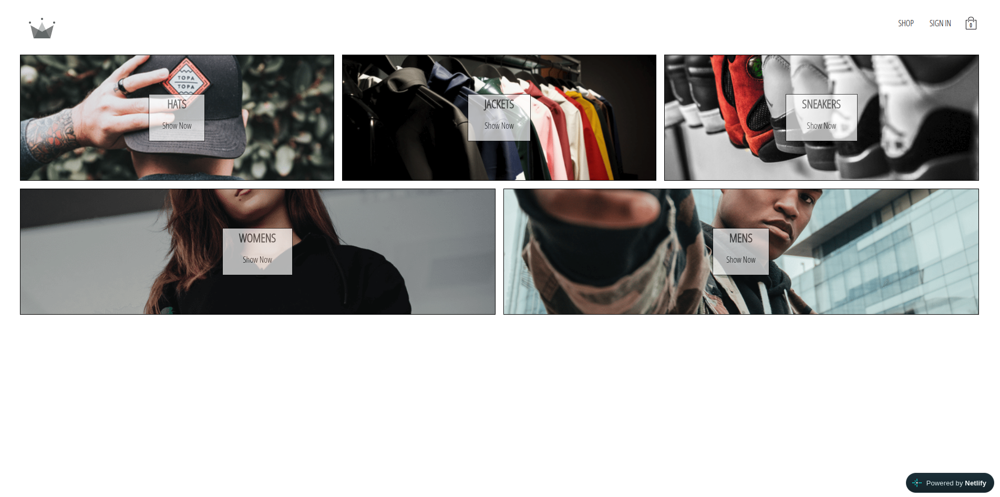

<div align="center">

# 🛍️ Crwn Clothing

[](https://react.dev) [](https://www.typescriptlang.org) [](https://redux-toolkit.js.org) [](https://firebase.google.com) [](https://stripe.com) [](https://vitejs.dev) [](https://www.netlify.com)

_An online clothing store with authentication, a persistent shopping cart and Stripe payments — built with React, TypeScript and Redux._

</div>

## 📖 About

Crwn Clothing is an e-commerce application built with React, TypeScript and Vite. Products are organized by category and loaded from Firebase Firestore. Users can sign up and sign in with email and password or with Google, fill a shopping cart that persists between visits, and pay with Stripe at checkout. Payments are processed by a Netlify serverless function, so the Stripe secret key never reaches the browser. Application state is managed with Redux Toolkit, with Redux-Saga handling the asynchronous flows, and the project is covered by unit and integration tests written with Vitest and React Testing Library.

## ✨ Features

- 🛒 **Shopping Cart** — add, remove and clear items, with a quick-view dropdown, an item counter and a full checkout page

- 💾 **Persistent Cart** — the cart is kept between visits with redux-persist

- 🔐 **Authentication** — sign up and sign in with email and password or with Google, powered by Firebase Auth

- 🗂️ **Product Categories** — categories and products loaded from Firestore, with a preview page and one page per category

- 💳 **Stripe Payments** — card payments through a Netlify serverless function (test mode)

- ⏳ **Loading States** — spinner while the categories are being fetched

- 📱 **PWA** — installable as an app on supported devices

- 🧪 **Tested** — components, reducers, selectors and sagas covered by automated tests

## 🖥️ Demo



🔗 [Live Demo](https://pmbfsa-crwn-clothing.netlify.app)

> 💳 Payments run in Stripe **test mode**. Use the card `4242 4242 4242 4242` with any future expiry date and any CVC.

## 🚀 Getting Started

### Prerequisites

- [Node.js](https://nodejs.org/) (v22 or higher recommended)
- npm
- A [Firebase](https://firebase.google.com) project with Authentication (Email/Password and Google) and Firestore enabled
- A [Stripe](https://stripe.com) account (test keys are enough)
- [Netlify CLI](https://docs.netlify.com/cli/get-started/) (to run the serverless function locally)

### Installation

1. Clone the repository:

```
git clone https://github.com/pmbfsa/crwn-clothing.git
cd crwn-clothing
```

2. Install dependencies:

```
npm install
```

3. Create a `.env` file in the project root (see [Environment Variables](#environment-variables)).

4. Start the development server with the serverless functions:

```
netlify dev
```

> `npm run dev` starts only the front end. Use `netlify dev` when you need the checkout to work, since it also runs the payment function.

5. Build for production:

```
npm run build
```

### Environment Variables

| Variable                 | Used by             | Description                                      |
| ------------------------ | ------------------- | ------------------------------------------------ |
| `VITE_GOOGLE_API_KEY`    | Front end           | Firebase Web API key                             |
| `VITE_STRIPE_PUBLIC_KEY` | Front end           | Stripe publishable key                           |
| `STRIPE_SECRET_KEY`      | Serverless function | Stripe secret key (never exposed to the browser) |

> Variables prefixed with `VITE_` are embedded in the public bundle. Never put secrets behind that prefix. The remaining Firebase settings (project id, auth domain, etc.) are defined in `src/utils/firebase/firebase.utils.ts` — replace them with your own project's values.

### Available Scripts

| Command            | Description                                       |
| ------------------ | ------------------------------------------------- |
| `npm run dev`      | Start the Vite development server                 |
| `npm run build`    | Type-check and build for production               |
| `npm run preview`  | Preview the production build locally              |
| `npm run lint`     | Run ESLint                                        |
| `npm test`         | Run the tests in watch mode                       |
| `npm run coverage` | Run the tests once and generate a coverage report |

## 🛠️ Built With

| Technology                                                                             | Version | Description                           |
| -------------------------------------------------------------------------------------- | ------- | ------------------------------------- |
| [React](https://react.dev)                                                             | 19.2.8  | UI library                            |
| [TypeScript](https://www.typescriptlang.org)                                           | 6.0     | Static typing                         |
| [Vite](https://vitejs.dev)                                                             | 8.2.2   | Build tool and dev server             |
| [Redux Toolkit](https://redux-toolkit.js.org)                                          | 2.12.0  | State management                      |
| [Redux-Saga](https://redux-saga.js.org)                                                | 1.5.1   | Asynchronous side effects             |
| [typed-redux-saga](https://github.com/agiledigital/typed-redux-saga)                   | 1.5.0   | Type-safe sagas                       |
| [redux-persist](https://github.com/rt2zz/redux-persist)                                | 6.0.0   | State persistence                     |
| [Reselect](https://github.com/reduxjs/reselect)                                        | 5.3.0   | Memoized selectors                    |
| [React Router](https://reactrouter.com)                                                | 8.3.0   | Routing                               |
| [styled-components](https://styled-components.com)                                     | 6.5.3   | CSS-in-JS styling                     |
| [SASS (sass-embedded)](https://sass-lang.com)                                          | 1.103.1 | Global styles                         |
| [Firebase](https://firebase.google.com)                                                | 12.18.0 | Authentication and Firestore database |
| [Stripe](https://stripe.com)                                                           | 22.6.0  | Payments (server SDK)                 |
| [Stripe React](https://docs.stripe.com/sdks/stripejs-react)                            | 6.8.2   | Payment form components               |
| [Netlify Functions](https://docs.netlify.com/build/functions/overview/)                | —       | Serverless backend for payments       |
| [Vitest](https://vitest.dev)                                                           | 5.0.1   | Test runner                           |
| [React Testing Library](https://testing-library.com/docs/react-testing-library/intro/) | 16.3.3  | Component testing                     |
| [redux-saga-test-plan](https://redux-saga-test-plan.jeremyfairbank.com)                | 4.0.6   | Saga testing                          |
| [ESLint](https://eslint.org)                                                           | 10.9.1  | Linting                               |
| [vite-plugin-pwa](https://vite-pwa-org.netlify.app)                                    | 1.3.0   | Progressive Web App support           |

## 📁 Project Structure

```
crwn-clothing/
├── netlify/
│   └── functions/          # Serverless function (Stripe payment intent)
├── public/                 # Static assets and PWA icons
├── src/
│   ├── assets/             # SVGs and images
│   ├── components/         # Reusable UI components
│   ├── routes/             # Pages (home, shop, category, authentication, checkout)
│   ├── store/              # Redux slices, sagas and selectors (user, cart, categories)
│   └── utils/              # Firebase helpers and test utilities
├── test/                   # Global test setup
├── eslint.config.ts
├── index.html
├── netlify.toml
├── package.json
├── screenshot.png
├── tsconfig.json
├── vite.config.ts
└── vitest.config.ts
```

## 📄 License

This project is licensed under the **GNU General Public License v3.0** — see the [LICENSE](https://github.com/pmbfsa/crwn-clothing/blob/main/LICENSE) file for details.
